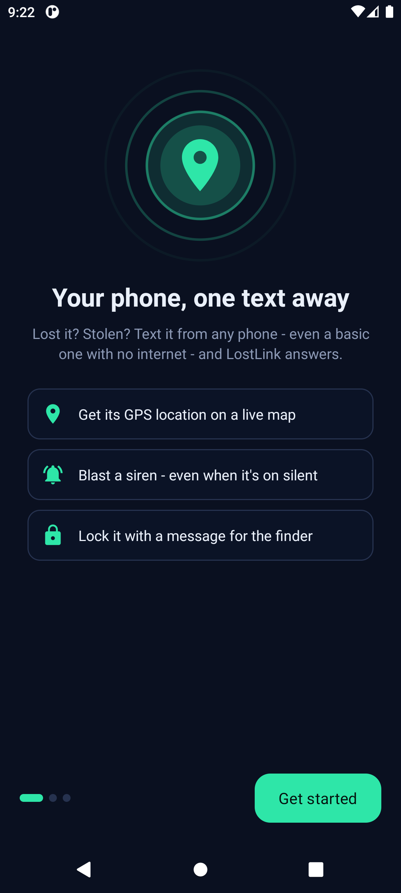
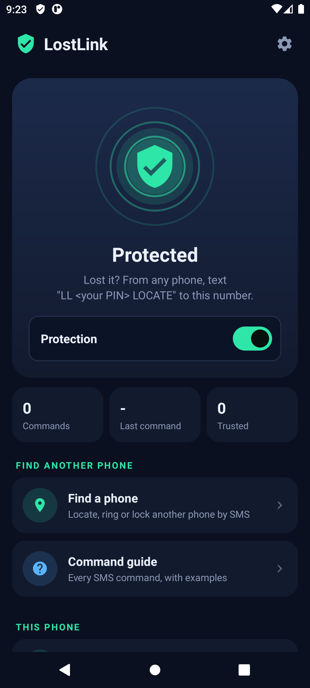
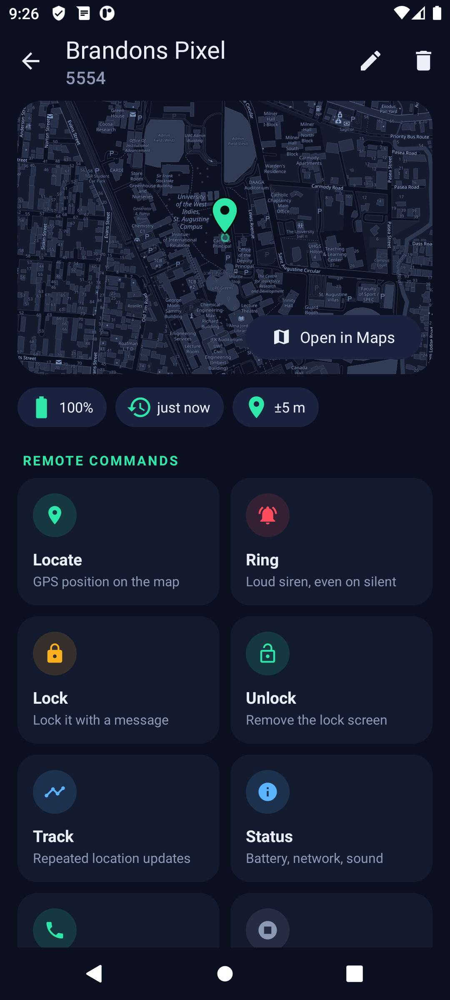
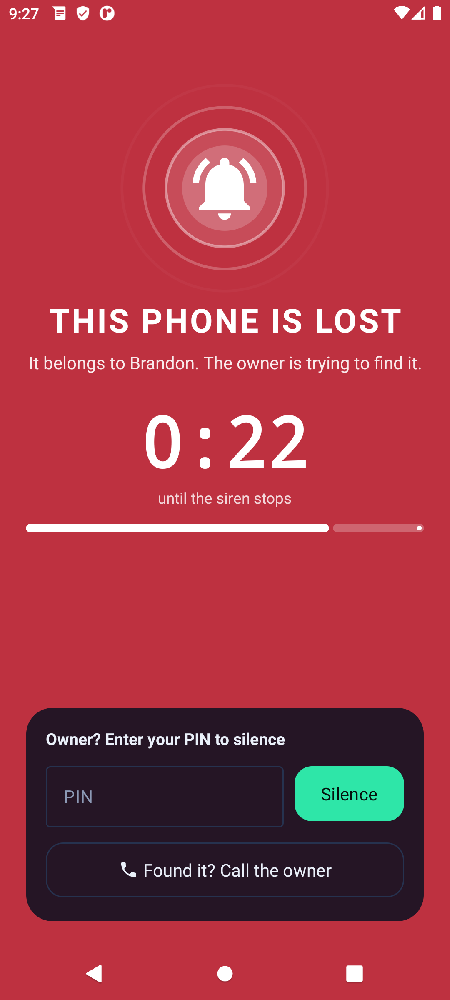
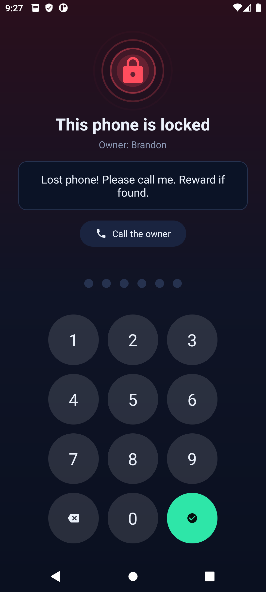
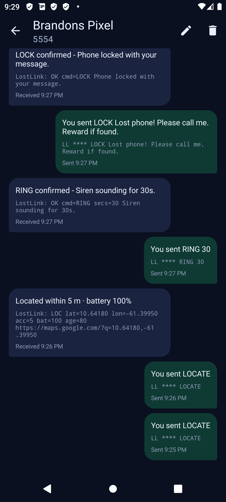
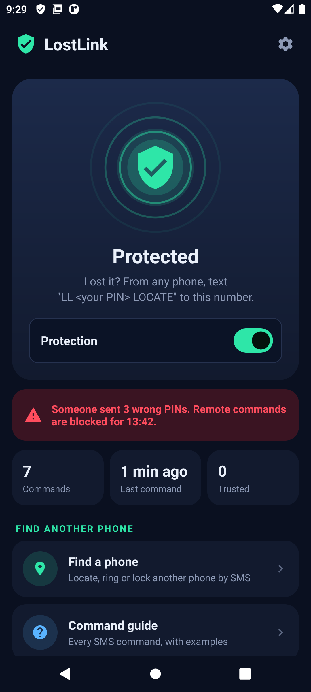
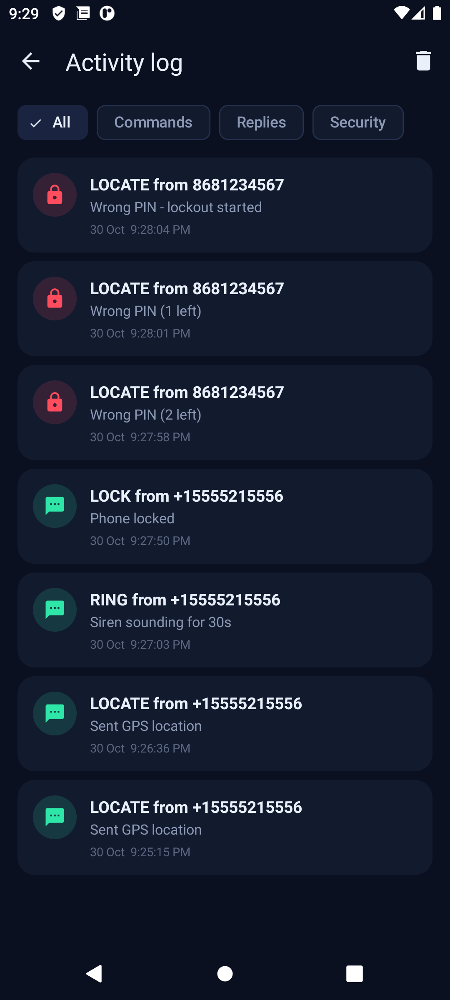

<div align="center">



# LostLink

**Find, ring and lock your Android phone with a single text message. No internet required.**


</div>

---

Most "find my phone" services need the lost phone to have mobile data or Wi‑Fi. LostLink doesn't. It turns ordinary **SMS** into a remote control: text your lost phone from **any** phone (a friend's smartphone, or a basic phone with no apps) and it answers with its GPS location, sounds a siren, or locks itself with a message for whoever finds it.

Built for **COMP3606 Wireless and Mobile Computing** at The University of the West Indies, St. Augustine.

## Screenshots

| Protected | Located on the map | Siren | Lock screen |
|:---:|:---:|:---:|:---:|
|  |  |  |  |

| SMS conversation | Wrong-PIN lockout | Activity log |
|:---:|:---:|:---:|
|  |  |  |

## Features

**On the protected phone**
- **Locate**: replies with GPS coordinates, accuracy, battery and a Google Maps link
- **Siren**: a loud, synthesised siren on the alarm stream (plays even on silent), with vibration, a strobing torch and a flashing full-screen alert
- **Lock**: a full-screen lock showing the owner's message and a *Call the owner* button; pressing Home doesn't escape it
- **Live tracking**: texts its location every *N* minutes, *M* times
- **Call me**: the lost phone calls you back
- **PIN protection**: every command needs the owner's PIN (stored only as a salted SHA‑256 hash)
- **Brute-force lockout**: 3 wrong PINs block remote commands for 15 minutes and text the owner's trusted contacts
- **Last-gasp alert**: when the battery drops to 10%, trusted contacts get the phone's last known location
- **Survives restarts**: protection comes back on after a reboot

**On the controller phone**
- A saved list of phones you can control
- A remote-control panel with one-tap commands
- A **dark live map** (OpenStreetMap) with the latest position, an accuracy circle and the tracking trail
- A **waiting-for-reply countdown** after each command
- A chat-style **SMS conversation** showing every command and its parsed reply

## How it works

```
 Controller phone (or ANY phone)                    Lost phone running LostLink
 ───────────────────────────────                    ───────────────────────────
  "LL 4821 LOCATE"   ───────── SMS ─────────▶  SmsReceiver (woken by Android)
                                                    │
                                                    ▼
                                               GuardService → CommandProcessor
                                                    │  check PIN, get GPS fix
                                                    ▼
  Pin dropped on map ◀──────── SMS ──────────  "LostLink: LOC lat=10.64180
  (ReplyProcessor)                                lon=-61.39950 acc=5 bat=100 ..."
```

### The SMS protocol

**Commands** are short and easy to type by hand:

```
LL <PIN> <COMMAND> [arguments]
```

**Replies** are readable by a person *and* parseable by the app (`key=value` pairs):

```
LostLink: LOC lat=10.64180 lon=-61.39950 acc=5 bat=100 age=0
https://maps.google.com/?q=10.64180,-61.39950
```

Replies use only characters from the basic **GSM 7-bit alphabet**. Characters like `[ ] { } | ~` belong to the GSM *extension table*, count as two characters, and were garbled in testing, so they're avoided on purpose.

### Commands

| Command | Example | What it does |
|---|---|---|
| `LOCATE` | `LL 4821 LOCATE` | Replies with GPS location, accuracy, battery and a map link |
| `RING` | `LL 4821 RING 60` | Siren for 5–300 seconds (default 60) |
| `STOP` | `LL 4821 STOP` | Silences the siren and stops tracking |
| `LOCK` | `LL 4821 LOCK Reward if found!` | Locks the screen with your message |
| `UNLOCK` | `LL 4821 UNLOCK` | Removes the lock screen |
| `STATUS` | `LL 4821 STATUS` | Battery, charging, network, sound mode, lock/tracking state |
| `TRACK` | `LL 4821 TRACK 2 5` | Location every 2 minutes, 5 times |
| `CALLME` | `LL 4821 CALLME` | The phone calls the sender back |
| `HELP` | `LL HELP` | Lists the commands (no PIN needed) |

Commands are case-insensitive. Texts that aren't LostLink commands are ignored, so normal messages are never affected.

## Project structure

```
app/src/main/java/com/comp3606/lostlink/
├── sms/        Protocol, SmsReceiver, SmsSender, CommandProcessor, ReplyProcessor, Alerts
├── guard/      GuardService (foreground service), AlarmController (siren), Tracker,
│               LocationHelper, Security (PIN hashing), Screens, Boot/Admin receivers
├── storage/    ObjectStore (ObjectOutputStream file storage), Repo
├── model/      Settings, SavedDevice, Ping, FeedEntry, LogEntry, TrustedContact (Serializable)
├── ui/         11 screens: Splash, Setup, Permissions, Main, Devices, Device, Log, Help,
│               TrustedContacts, Ring, Lock (+ RadarView custom view)
└── util/       LiveEvents (in-app event bus), Notifier, Phone helpers
```

### Course requirements

| Requirement | Where |
|---|---|
| Communication via SMS (send + receive + processing) | `sms/SmsSender`, `sms/SmsReceiver`, `sms/CommandProcessor`, `sms/ReplyProcessor` |
| Saving objects to files | `storage/ObjectStore`: `settings.dat`, `devices.dat`, `activity_log.dat` |
| Exit button | Home screen (`ui/MainActivity`) |
| Multiple screens | 11 activities in `ui/` |
| Timers | Siren countdown, reply-wait countdown, lockout countdown, tracking interval, splash timer, lock-screen cooldown |

## Getting started

### Requirements
- Android Studio (Ladybug or newer)
- JDK 17+ (the one bundled with Android Studio works)
- Android SDK 36
- A device or emulator running Android 8.0 (API 26) or newer

### Build
```bash
git clone https://github.com/M3RCU3Y/LostLink.git
cd LostLink
./gradlew assembleDebug
```
Or open the folder in Android Studio and press **Run**.

### Try it with two emulators (free, no SIM needed)

Android emulators can text each other using their **console port** as the phone number.

1. Start two emulators. The first is usually `emulator-5554` and the second `emulator-5556`.
2. Install LostLink on both.
3. **Emulator 5554 (the "lost" phone):** finish setup, choose a PIN, allow the permissions and switch **Protection** on.
4. **Emulator 5556 (the controller):** open **Find a phone → Add a phone**, enter number `5554` and the PIN from step 3.
5. Tap **Locate**. To give the emulator a position, use the emulator's *Extended controls → Location*, or run:
   ```bash
   adb -s emulator-5554 emu geo fix -61.3995 10.6418
   ```

You can also pretend to be a **basic phone** by injecting a raw SMS:
```bash
adb -s emulator-5554 emu sms send 8681234567 "LL 4821 RING 30"
```

### Permissions

| Permission | Why |
|---|---|
| `RECEIVE_SMS`, `SEND_SMS` | Receive commands, send replies |
| `ACCESS_FINE_LOCATION` | Answer `LOCATE` / `TRACK` |
| `FOREGROUND_SERVICE_LOCATION` | Keep listening, and read GPS while the screen is off |
| `SYSTEM_ALERT_WINDOW` | Open the siren and lock screen from the background |
| `POST_NOTIFICATIONS`, `USE_FULL_SCREEN_INTENT` | Status notification; wake the screen for alerts |
| `CALL_PHONE` *(optional)* | `CALLME` |
| Device admin *(optional)* | Let `LOCK` also lock the real screen |

The in-app **Permissions** screen walks through each one.

## Limitations

- Incoming command texts still show up in the phone's normal messaging app. Only the default SMS app can hide them.
- The LostLink lock screen is an app-level lock. For a full system lock, enable the optional device-admin permission.
- SMS costs whatever your carrier charges. Testing between emulators is free.
- Very aggressive battery savers on some phone brands may stop the background service. Exclude LostLink from battery optimisation for best results.

## Team

| Member | Role |
|---|---|
| Brandon Deonarine | _To be decided_ |
| _Name_ | _Role_ |
| _Name_ | _Role_ |
| _Name_ | _Role_ |

## Acknowledgements

- SMS sending follows the COMP3606 lecturer's `SmsManager` lab pattern.
- Maps by [osmdroid](https://github.com/osmdroid/osmdroid) using © [OpenStreetMap](https://www.openstreetmap.org/copyright) contributors.
- Icons from [Material Design Icons](https://fonts.google.com/icons).
